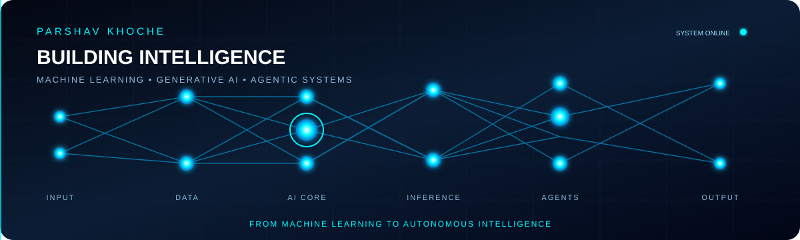

<h1 align="center">Hi, I'm Parshav Khoche 👋</h1>

<strong>AI Engineer · Machine Learning · Agentic Systems</strong>

  

  

  
  
  
  

## About

I'm an AI and Machine Learning Engineer interested in building reliable, useful AI products. I work across machine learning, computer vision, generative AI, and agentic systems.

Currently a Software Engineer Intern at **A3 Services**.

## Focus & tools

- **AI:** LLMs, RAG, embeddings, vector search, LangChain, LangGraph, FAISS, Ollama
- **ML:** PyTorch, scikit-learn, EfficientNet, YOLO, OpenCV
- **Engineering:** Python, C++, FastAPI, Docker, Git, Linux, PostgreSQL

## Featured projects

- **Sugarcane AI Agent** — Agricultural knowledge assistant using document retrieval, FAISS, RAG, and LLM-powered workflows.
- **Sugarcane Disease Detection** — Five-class leaf disease classifier built with PyTorch, EfficientNet-B0, and a FastAPI inference backend.
- **Peanut Leaf Disease Detection** — Custom-dataset object detection project using YOLOv8 and OpenCV.

## Education

**B.Tech in Computer Science and Engineering** — D.Y. Patil Agriculture and Technical University, Talsande

## GitHub activity

  

  

